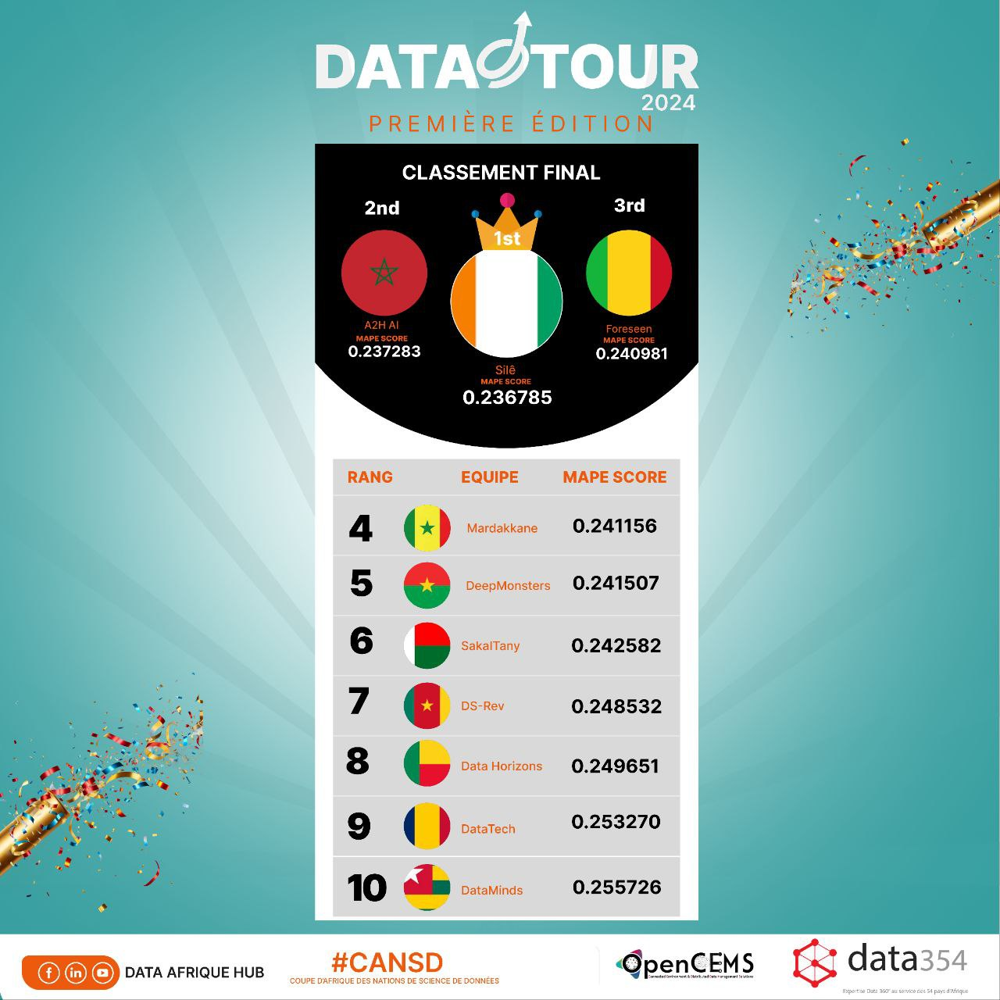
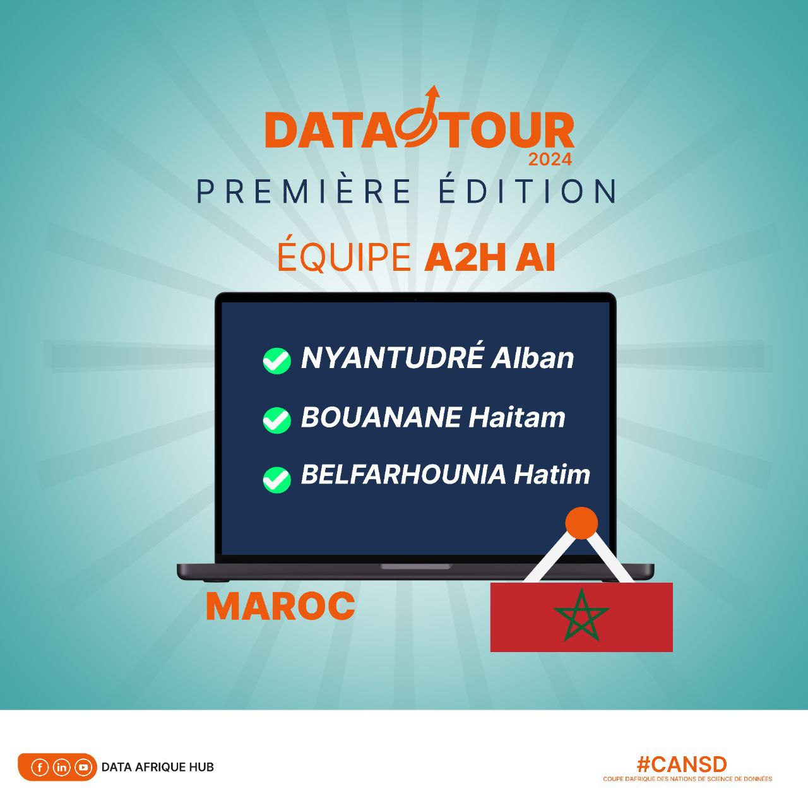

<h1 align="center">DataTour 2024 Forecasting</h1>

Our team's code for the first edition of [DataTour](https://github.com/dataafriquehub), the African data science competition that Data Afrique Hub ran in 2024. Our team, A2H AI (Morocco), finished **2nd in the final**, out of more than 100 teams from about ten African countries ([announcement on LinkedIn](https://www.linkedin.com/feed/update/urn:li:activity:7279857937290821632/)).

  
  &nbsp;
  

## The two rounds

| Round | Task | Metric | Folder |
|---|---|---|---|
| National phase (November 2024) | Forecast the projected energy demand of African regions to plan solar infrastructure | RMSE | [national-phase-solar-energy](national-phase-solar-energy) |
| Final (December 2024) | Forecast the number of units of each product sold in November 2024 from past sales and context (promotions, holidays, weather, stock) | MAPE | [final-sales-forecasting](final-sales-forecasting) |

Our final predictions scored a MAPE of 0.237283 on the leaderboard, 0.0005 behind the winning team.

## Team

- Wendyellé Abubakrh Alban NYANTUDRE ([LinkedIn](https://www.linkedin.com/in/anyantudre/))
- Haitam Bouanane ([LinkedIn](https://ma.linkedin.com/in/haitam-bouanane-656783221))
- Hatim Belfarhounia ([LinkedIn](https://www.linkedin.com/in/hatim-belfarhounia-7a8932291))

Thanks to Data Afrique Hub for organizing the competition and sharing the datasets.
