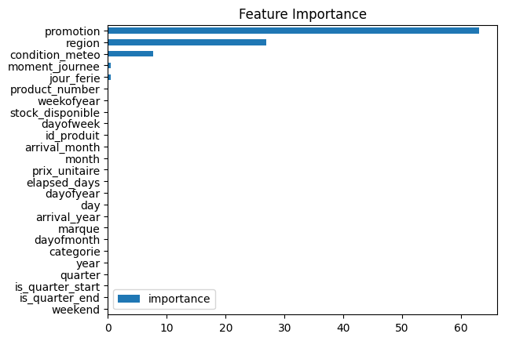
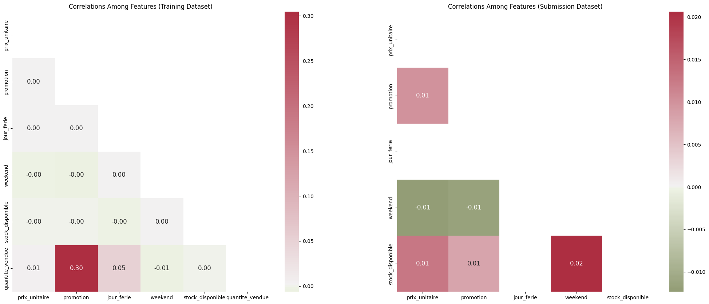

<h1 align="center">Sales Forecasting (final, 2nd place)</h1>

Forecasting how many units of each product a company sells, from past sales, promotions, holidays, weather and stock. Most of the work went into filling the many gaps in the data, then into gradient-boosted trees combined by vote. Our predictions finished **2nd in the DataTour 2024 final**, with a MAPE of 0.237283.

| Feature importance (CatBoost) | Correlations |
|---|---|
|  |  |

## The task

Final of DataTour 2024. The training data has 83,047 daily sales from January 2022 to October 2024, for 150 products of 15 brands in 3 categories. Each sale has its date, price, promotion and holiday flags, weekend, available stock, weather, region and time of day. The goal is to predict `quantite_vendue`, the units sold, for 2,576 sales in November 2024, scored with the mean absolute percentage error (MAPE). The data comes from [Data Afrique Hub](https://github.com/dataafriquehub/donnee_vente).

## What the data shows

- Only 10,923 rows are complete. 11,407 have no target, and most columns have thousands of gaps.
- Promotion is the only feature clearly linked to sales (correlation 0.30). The models also rely on region and weather.
- The November rows look like the training data, and holidays only fall in December.

## Approach

- We fill the gaps from the structure of the data: the product ID from category and brand, the weekend flag from the date, the holiday flag from the month, price, brand and stock from the product, the weather from region and time of day, and the promotion flag with a random forest.
- We add date features and features from the product ID: arrival year and month, product number and days since arrival.
- We train six models: XGBoost, CatBoost, LightGBM, HistGradientBoosting, gradient boosting and random forest. Their predictions are rounded to whole units and combined by majority vote.
- We also ran AutoGluon for comparison.
- `src/` holds a script version with 5-fold training, Optuna tuning, a model dispatcher with the tuned settings and a voting regressor.

## Results

| Model | Validation MAPE |
|---|---|
| Single models (XGBoost, CatBoost, LightGBM, HistGradientBoosting) | 0.2525 to 0.2529 |
| Majority vote of six models, rounded | 0.2449 |
| AutoGluon weighted ensemble | 0.2451 |
| **Final leaderboard** | **0.2373** (2nd) |

## Files

| Path | Content |
|---|---|
| `notebooks/` | the main notebook (exploration, imputation, models) and the AutoGluon run |
| `src/` | folds, preprocessing, model dispatcher, Optuna tuning, training and inference scripts |
| `utils/` | EDA and feature engineering helpers |
| `input/` | the training data with folds, and the sample submission |
| `artifacts/` | submission files from each team member and model |

## Run it

```bash
make install   # pip install -r requirements.txt
make folds     # create the folds
make train     # train the model set in src/config.py
python src/inference_label_tree.py
```

Use `src/inference_label_tree.py` for predictions: the Makefile's `inference` target points to a script name that no longer exists. On scikit-learn 0.24 and later, `src/create_folds.py` needs `shuffle=True` in its `KFold`, because it sets a `random_state`.
