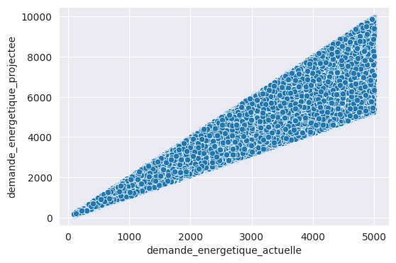
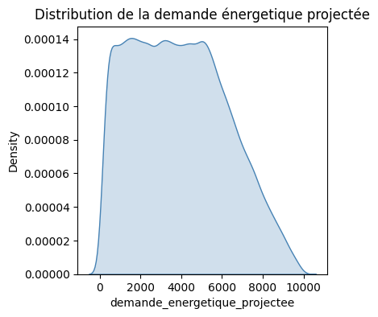

<h1 align="center">Solar Energy Demand Forecasting (national phase)</h1>

  

Forecasting how much energy African regions will need, to plan where to build solar infrastructure. The models are gradient-boosted trees and a stacked ensemble.

  

## The task

National phase of DataTour 2024. Each row is a region with its country, location, population, current energy demand, installed capacity, sunshine, solar installation cost, renewable adoption, political stability, access to energy, urbanization, soil type, CO₂ avoided and human development index. The target is `demande_energetique_projectee`, the projected energy demand, scored with the RMSE.

| File | Rows | Use |
|---|---|---|
| `train.csv` | 150,000 | training, with the target |
| `test.csv` | 62,500 | also labelled; added to the training data |
| `submission.csv` | 25,000 | predictions to submit |

The data covers 53 countries and is read directly from Data Afrique Hub's GitHub.

## What the data shows

| Current vs projected demand | Projected demand |
|---|---|
|  |  |

Current demand is the only strong signal: its correlation with the target is 0.94, and the projected demand always falls between about one and two times the current demand. Every other column has a correlation close to zero, including two noise columns (`habit_de_mariage`, `nombre_animaux_domestiques`).

## Approach

- We merge train and test (212,500 rows), drop the country, one-hot encode the soil type and the noise column, and fill the missing renewable adoption rates with the mean.
- We add five PCA components to the features.
- We keep 10% of the data aside and run 5-fold cross-validation on the rest.
- We train seven models: linear regression, Lasso, LightGBM, HistGradientBoosting, XGBoost, CatBoost and gradient boosting. A least-absolute-deviation (LAD) regression and a linear regression then stack their predictions.
- The submission averages the LAD ensemble over the five folds.

## Results

| Model | CV RMSE | Holdout RMSE |
|---|---|---|
| Linear regression | 798.95 | 800.12 |
| XGBoost | 799.46 | 800.09 |
| CatBoost | 799.25 | 800.15 |
| LightGBM | 799.51 | 800.61 |
| HistGradientBoosting | 799.54 | 800.12 |
| LAD ensemble | 798.86 | 800.23 |
| Linear ensemble | 798.81 | 800.28 |

All models land within about 1.5 RMSE of each other, for a target with a standard deviation of 2,302. Current demand explains most of the target, and what remains is mostly noise. The ensemble CV scores come from the same predictions their meta-model was fitted on, so the holdout column gives the fairer comparison.

## Files

- [notebooks/solar_energy_forecasting_last.ipynb](notebooks/solar_energy_forecasting_last.ipynb): exploration, features, models and submission.
- [notebooks/Epreuve_Phase_Nationale.ipynb](notebooks/Epreuve_Phase_Nationale.ipynb): the organizers' problem statement (in French).

The notebook runs on Colab. It calls a few plotting helpers that it doesn't define, so add them before running it from start to finish.
